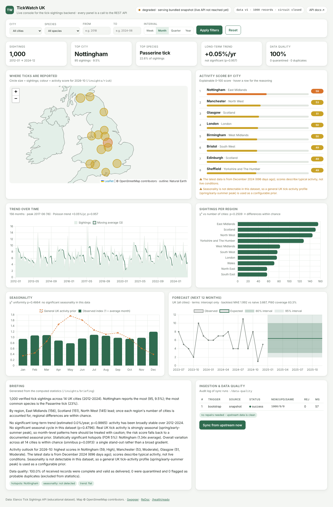
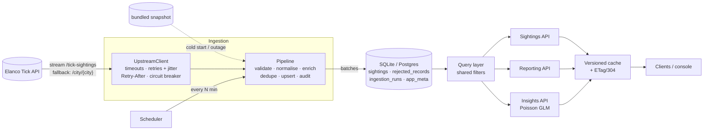
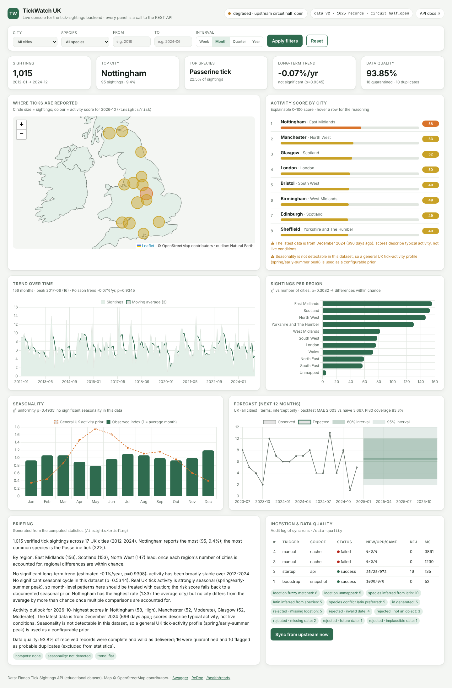

# TickWatch UK — Tick Sightings Backend

**Elanco Placement Programme · Technical Task (Backend)** — by **Labib Abdin**

A production-minded MVP backend that consumes the Elanco Tick Sightings API, turns it into a clean,
queryable dataset, and serves search, reporting and statistical insights over a documented REST API.



> The screenshot is the built-in **console** at `/` — a single static page whose every panel is a
> call to the REST API. It exists to make the backend easy to demo; the backend is the product.

---

## Contents

1. [Quick start](#1-quick-start)
2. [What it does](#2-what-it-does)
3. [Architecture](#3-architecture)
4. [Data handling strategy](#4-data-handling-strategy)
5. [Search & filtering](#5-search--filtering)
6. [Reporting endpoints](#6-reporting-endpoints)
7. [AI/ML insights (extension)](#7-aiml-insights-extension)
8. [Error handling & resilience](#8-error-handling--resilience)
9. [Testing & quality](#9-testing--quality)
10. [Technology choices](#10-technology-choices)
11. [Project structure](#11-project-structure)
12. [What I'd do with more time](#12-what-id-do-with-more-time)

Deeper write-ups: [`docs/ARCHITECTURE.md`](docs/ARCHITECTURE.md) (decisions, trade-offs, failure modes) ·
[`docs/VIDEO_SCRIPT.md`](docs/VIDEO_SCRIPT.md) (10-minute walkthrough plan).

---

## 1. Quick start

Requires **Python 3.11+** (or Docker). No database server, no API keys.

**macOS / Linux**

```bash
git clone <this repo> && cd elanco-tick-tracker
python3 -m venv .venv && source .venv/bin/activate
pip install -r requirements-dev.txt
uvicorn app.main:app --reload
```

**Windows (PowerShell)**

```powershell
git clone <this repo>; cd elanco-tick-tracker
py -3 -m venv .venv; .venv\Scripts\Activate.ps1      # if blocked: Set-ExecutionPolicy -Scope Process Bypass
pip install -r requirements-dev.txt
uvicorn app.main:app --reload
```

Then open:

| URL | What |
|---|---|
| http://127.0.0.1:8000/ | Console (map, charts, risk scores, ingestion log) |
| http://127.0.0.1:8000/docs | Interactive Swagger docs for every endpoint |
| http://127.0.0.1:8000/health/ready | Readiness: data freshness, circuit breaker, cache |

On first start the database is seeded from a bundled snapshot in under a second (so the API is never
empty, even offline), then a background sync pulls the live API and repeats every 60 minutes.

**Other ways to run**

```bash
pytest -q                     # 125 tests (unit, integration, API, statistical)   [or: make test]
bash scripts/demo.sh          # guided curl tour of the API (Windows: run it from Git Bash)
docker compose up --build     # containerised, data persisted in a volume
docker compose --profile postgres up --build   # same API on PostgreSQL (http://localhost:8002)

# Resilience demo: a misbehaving fake upstream + an API instance that ingests from it
python -m tools.chaos_upstream --port 9000 --preset chaos
UPSTREAM_BASE_URL=http://127.0.0.1:9000/data DATABASE_URL=sqlite:///data/chaos.db uvicorn app.main:app --port 8001
# ...or all of it at once: docker compose --profile chaos up --build
```

On Windows PowerShell, set environment variables first (in its own window, since they last for that window):

```powershell
$env:UPSTREAM_BASE_URL = "http://127.0.0.1:9000/data"; $env:DATABASE_URL = "sqlite:///data/chaos.db"
uvicorn app.main:app --port 8001
```

All configuration is via environment variables or a `.env` file — see [`.env.example`](.env.example).

---

## 2. What it does

| Requirement | Delivered |
|---|---|
| **Data handling** — consume the API; large datasets, duplicates, incomplete data | Streaming, batched, idempotent ingestion with validation, normalisation, near-duplicate detection, quarantine of bad records and a full audit log ([§4](#4-data-handling-strategy)) |
| **Search & filter** by time range and location | Time range (dates, months or years), city / region / nation, **radius around a point**, species (common or Latin), free text, pagination, sorting, CSV/NDJSON export ([§5](#5-search--filtering)) |
| **Reporting** — sightings per region, weekly/monthly trends | Per city/region/nation (+GeoJSON), zero-filled trends by day/week/month/quarter/year with a proper trend test, seasonality, heatmaps, summary ([§6](#6-reporting-endpoints)) |
| **AI/ML insights** (extension) | Poisson GLM diagnostics (trend, seasonality, hotspots), forecasts with prediction intervals **and a backtest**, FDR-controlled anomaly detection, an explainable 0–100 activity score, a plain-English briefing ([§7](#7-aiml-insights-extension)) |
| **Error handling** — API failures and data inconsistencies | Timeouts, jittered retries, `Retry-After`, circuit breaker, per-city fallback, last-known-good data, one consistent error envelope, readiness probe ([§8](#8-error-handling--resilience)) |
| Docs & thought process | This README, [ARCHITECTURE.md](docs/ARCHITECTURE.md), OpenAPI docs, video script |

### What I found when I probed the upstream API

Before designing anything I explored `https://dev-task.elancoapps.com/data` (OpenAPI 3, public, read-only):

* `GET /tick-sightings` returns **all 1,000 records in one unpaginated array** (~140 KB);
  `?limit=`/`?page=` are silently ignored. Also `/tick-sightings/{id}`, `/city/{city}`, `/species/{species}`, `/stats`, `/health`.
* Records look like `{"id","date","location","species","latinName"}`; **14 UK cities**, **5 species**, Jan 2012 → Dec 2024.
* `/city/{city}` and `/species/{species}` are **case-sensitive** and only accept the common name
  (`/city/london` → `[]`), and unknown ids return `404 {"error":"Not found"}`.
* Under 30 concurrent requests, latency jumped from ~0.3 s to **~4 s** (cold starts behind Google Frontend) —
  hence explicit timeouts and *bounded* concurrency for per-city fallback.
* The live data is **clean** — no duplicates, gaps or bad dates — and statistically **pattern-free** (uniform
  over months, no trend). So I built a [chaos upstream](tools/chaos_upstream.py) to prove the cleaning and
  resilience paths, and made sure the insights engine *reports* the absence of patterns rather than inventing them.

---

## 3. Architecture



* **One process, layered modules.** `ingestion/` (client, cleaning, pipeline, scheduler), `services/` (query,
  analytics, quality), `insights/` (GLM, engine, narrative), `api/` (thin FastAPI routers).
* **Read path never touches the upstream.** Requests are served from the local store, so the API stays fast
  and available while the upstream is slow or down.
* **One filter object everywhere.** `?city=London&start=2020` means the same thing for listings, aggregates,
  forecasts and risk scores.
* **Cache invalidation by data version.** Every ingestion run that changes data bumps `data_version`; cache keys
  and ETags include it, so cached aggregates are never stale and need no explicit invalidation.

---

## 4. Data handling strategy

### Consuming the API

| Concern | Approach |
|---|---|
| **Large datasets** | The full feed is *streamed* and parsed incrementally (`ijson`, C backend), handed to the pipeline in fixed-size batches (default 500). Memory stays flat regardless of payload size. Writes are bulk inserts/updates; exports stream from a server-side cursor. |
| **Scale evidence** | `make bench` streams **200,000** synthetic records through the real pipeline: ~25 s (≈8k rows/s on SQLite), peak memory **+44 MB** over baseline; a no-op re-sync takes ~13 s; heavy aggregates on 200k rows run in 0.05–1.2 s (then cached). |
| **Fallback source** | If the single big request keeps failing, fetch `/city/{city}` per known city with bounded concurrency (4) — smaller requests survive where a large one times out. |
| **Idempotency** | Upsert keyed by upstream id + content hash: unchanged rows are only "touched", changed rows updated, new rows inserted. A retried stream that re-delivers batches cannot create duplicates. |
| **Deletions upstream** | Soft-deactivation (`is_active=false`) of rows not seen in a *complete* full sync — never after a partial or per-city sync. A safety valve refuses to deactivate >50% of the data in one run (protects against an upstream bug returning a near-empty list). |
| **Scheduling** | Immediate sync at start-up, then every `SYNC_INTERVAL_MINUTES`; manual trigger at `POST /api/v1/ingestion/sync`. A lock prevents overlapping runs. |
| **Audit** | Every run is recorded in `ingestion_runs` (trigger, source, status, counts, warnings, quality counters, duration) and exposed at `/api/v1/ingestion/runs`. |

### Cleaning rules (all in [`app/ingestion/cleaning.py`](app/ingestion/cleaning.py), pure and unit-tested)

The principle: **keep what is usable, quarantine what is not, and never repair silently.** A record is only
rejected if it can't answer *when* and *where*. Every repair leaves a `quality_flags` entry, and the raw upstream
values are stored alongside the cleaned ones (lineage).

| Problem | Handling |
|---|---|
| Not a JSON object | reject `not_an_object` |
| Missing / unparseable date | reject `missing_date` / `invalid_date` (ISO with/without `Z` or offset, `dd/mm/yyyy`, epoch s/ms are all accepted) |
| Date in the future / before 1990 | reject `future_date` / `implausible_date` |
| Missing location | reject `missing_location` |
| `"  MANCHESTER "`, `Manchster`, `Newcastle upon Tyne` | normalised to the canonical city via a gazetteer (case, whitespace, aliases, fuzzy match); fuzzy matches flagged |
| Town not in the gazetteer | kept, flagged `location_unmapped` (no region/coordinates); excluded from model fitting |
| Common name missing | inferred from Latin name (and vice versa), flagged |
| Common and Latin names disagree | Latin name wins (less ambiguous), flagged `species_conflict_latin_preferred` |
| No species at all | kept as `Unidentified`, flagged |
| Missing id | deterministic content-hash id, flagged `id_generated` |
| Alternative field names (`City`, `latin_name`, `sighting_id`…) | mapped to the canonical schema |
| Same id twice in one feed | first copy kept (unless a later one is strictly more complete) |
| **Probable duplicate report** (same city + species within 5 min, different id) | kept but linked via `duplicate_of` to the first report of the burst; excluded from all statistics by default (`include_duplicates=true` to include). Detection runs **inside the database** with a `LAG()` window function, so it scales with the number of duplicates, not the table. |

Every row is enriched with **region, nation and coordinates** (ONS regions; Scotland/Wales/NI as nations) — this
is what makes "sightings per region" and radius search possible from a city-only feed.

`GET /api/v1/data-quality` reports what came in, what was repaired, what was rejected and why (with samples of
quarantined payloads). Against the chaos feed it shows a 93.8% quality score, 16 quarantined records and 10
duplicates — and the statistics are unaffected.


*Console pointed at the chaos upstream after an injected outage: status "degraded · circuit open", the failed run
in the audit log, repairs and rejections listed — and every chart still served from the last good data.*

---

## 5. Search & filtering

`GET /api/v1/sightings` — every filter also works on every reporting and insights endpoint.

| Parameter | Example | Notes |
|---|---|---|
| `start`, `end` | `2020-01-01`, `2021-06`, `2019` | Inclusive; a bare `end` date includes that whole day; month/year shorthands |
| `city` | `London`, `manchster`, `Leeds,York` | Case-insensitive, typo-tolerant; repeat or comma-separate for OR |
| `region`, `nation` | `North West`, `Scotland` | ONS regions / UK nations |
| `lat`, `lon`, `radius_km` | `53.48`, `-2.24`, `50` | "Near me" search (haversine against city coordinates) |
| `species` | `Marsh tick` or `Ixodes apronophorus` | Common or Latin name |
| `q` | `canisuga` | Free text over city, region, species, Latin name |
| `include_duplicates`, `include_inactive` | `true` | Off by default |
| `page`, `page_size`, `sort`, `order` | `2`, `100`, `city`, `asc` | `page_size` capped at 500; `next`/`prev` links returned |

```bash
curl "localhost:8000/api/v1/sightings?species=marsh%20tick&region=Scotland&start=2020&end=2022&page_size=5"
curl "localhost:8000/api/v1/sightings?lat=51.5&lon=-0.12&radius_km=25"
curl "localhost:8000/api/v1/sightings/export?format=csv&city=Leeds" -o leeds.csv
curl "localhost:8000/api/v1/sightings/02WNholuSg6ndCk4c1dA"     # one record + lineage + probable duplicates
```

Invalid input never produces an empty result silently — it produces a helpful 422:

```json
{"error": {"code": "unknown_location", "message": "Unknown location 'Sheffeld Town'.",
           "details": {"parameter": "city", "suggestions": ["Sheffield"]}, "request_id": "51ab7c22b6f34f29"}}
```

---

## 6. Reporting endpoints

| Endpoint | Returns |
|---|---|
| `GET /api/v1/stats/summary` | Totals, span, top city/species, by nation, last-12-months vs previous, last sync |
| `GET /api/v1/stats/by-location?group_by=city\|region\|nation` | Counts, share, per-year rate, index vs average, coordinates; **χ² test** of whether groups differ beyond chance (for regions, the null accounts for how many cities each contains) |
| `GET /api/v1/stats/by-location.geojson` | City counts as a GeoJSON FeatureCollection (drop-in for any map) |
| `GET /api/v1/stats/species` | Per-species counts with Latin names |
| `GET /api/v1/stats/trends?interval=day\|week\|month\|quarter\|year` | **Zero-filled** series (empty weeks are present as 0 — charts don't lie), moving average, peak, `split_by=species\|city\|region` (top N + "Other"), and a **Poisson-regression trend test** (% change/year, 95% CI, p-value) |
| `GET /api/v1/stats/seasonality` | Month-of-year, season, weekday and hour distributions with a uniformity test |
| `GET /api/v1/stats/heatmap?rows=city&cols=month` | Two-way matrix with a χ² independence test |
| `GET /api/v1/meta/locations \| regions \| species` | Reference data with counts |

Aggregations run as SQL `GROUP BY`s (time buckets are the only dialect-specific SQL, isolated in one function
and tested against the Python bucketing). Responses carry `ETag` and `X-Data-Version`; a conditional request
returns `304 Not Modified` until the data changes.

---

## 7. AI/ML insights (extension)

Rather than a black box, one interpretable model underpins everything — a **Poisson GLM** of monthly sighting
counts per city (the textbook model for event counts):

    log E[count(city, month)] = intercept + trend·t + season[month] + effect[city]

with sum-to-zero coding so `exp(effect)` reads as "× the average city". Each term is kept only if a
likelihood-ratio test says it earns its place; overdispersion is handled quasi-Poisson style (and with a
negative binomial for intervals/tails).

| Endpoint | What it answers |
|---|---|
| `GET /api/v1/insights/overview` | Is there a trend? A seasonal cycle? Real hotspots? — LR tests, rate ratios with 95% CIs, Benjamini–Hochberg q-values, plain-English findings |
| `GET /api/v1/insights/forecast?horizon=12[&for_city=Leeds]` | Expected sightings per month with **80/95% prediction intervals** from 4,000 posterior-predictive simulations; a **backtest** that refits without the last 12 months and compares MAE to naive baselines and checks interval coverage |
| `GET /api/v1/insights/anomalies?granularity=month\|quarter\|year` | City-periods far above/below model expectation, with **false-discovery-rate control** across all tests |
| `GET /api/v1/insights/risk?month=2025-05` | Explainable 0–100 **activity score** per city: empirical-Bayes blend of recent and long-term rates × seasonal factor × trend factor, with a sentence explaining each score |
| `GET /api/v1/insights/risk/near?at_lat=..&at_lon=..` | The score for a user's location (inverse-distance weighted over nearby cities) |
| `GET /api/v1/insights/briefing` | Everything above as a short narrative — generated from templates over computed numbers, so nothing is hallucinated |

**What it concludes on the real data — and why that's the right answer.** The engine finds *no* trend
(p≈0.99), *no* seasonality (p≈0.48), and one stand-out city (Nottingham, 1.34× average, q≈0.045) in an
otherwise homogeneous set. The forecast is therefore flat, and its backtest honestly shows **0% skill over the
historical mean** (but 46% lower error than seasonal-naive) with 83% coverage for 80% intervals — calibrated.
Because real UK tick activity *is* strongly seasonal, the risk score falls back to a documented, configurable
seasonal prior and says so in its `warnings`.

The tests prove the converse too: on simulated data with a real seasonal cycle, growth and a hotspot, the same
code detects all three, picks May/June as the peak, beats the naive baselines, and flags an injected spike
while raising essentially no false alarms (`tests/test_insights.py`).

---

## 8. Error handling & resilience

**Talking to the upstream** ([`app/ingestion/client.py`](app/ingestion/client.py))

| Failure | Response |
|---|---|
| Slow / hanging server | Separate connect (5 s) and read (20 s) timeouts |
| Timeouts, resets, 408/429/5xx, truncated JSON, HTML error pages | Retried with exponential backoff and **full jitter** (no synchronised retry storms); `Retry-After` honoured |
| 404 / other 4xx / wrong payload shape / oversized payload | Not retried — fail fast with a precise error |
| Sustained outage | **Circuit breaker** opens after 5 consecutive failures, short-circuits calls for 60 s, then lets one trial request through (half-open) |
| Stream drops mid-way | Whole request retried; re-delivered rows skipped; the run notes it |
| Full feed keeps failing | Fall back to per-city requests (bounded concurrency) |
| Everything fails | Keep serving the last good data (or the bundled snapshot if the DB is empty); `/health/ready` reports `degraded` with reasons |

**Serving clients** ([`app/errors.py`](app/errors.py))

* One error envelope for every non-2xx: `{"error": {"code", "message", "details", "request_id"}}` — validation
  errors list each bad field; unknown cities/species/regions come with suggestions; 500s never leak internals.
* `X-Request-ID` is accepted or generated, echoed on every response and included in every JSON log line.
* `/health` (liveness) vs `/health/ready` (readiness): 200 + `degraded` when serving stale data, 503 only when
  there is no data at all — so an orchestrator doesn't kill a pod that is usefully serving cached data.
* The admin sync endpoint can be protected with `ADMIN_API_KEY`; concurrent syncs return 409.

---

## 9. Testing & quality

**125 tests**, ~12 s, no network (`respx` mocks the upstream):

| File | Covers |
|---|---|
| `test_cleaning.py` | Every validation and normalisation rule; date formats; duplicate policies |
| `test_client.py` | Retries, `Retry-After`, non-retryable errors, timeouts, truncated streams, breaker state machine, fail-fast when open, streaming batch sizes |
| `test_pipeline.py` | Idempotency, updates, soft-deletes + safety valve, per-city fallback, outage with/without existing data, the full dirty feed, stream restarts, SQL-vs-Python duplicate detection |
| `test_api.py` | Every filter, pagination, sorting, error envelopes, request ids, CSV export, zero-filled trends, SQL vs Python bucketing, ETag/304, admin key, unhandled-error masking |
| `test_insights.py` | GLM recovers known coefficients; detects seasonality/trend/hotspot when present and **doesn't** when absent; finds an injected anomaly with FDR control; interval ordering; backtest; risk explanations |

Lint/format with `ruff`. GitHub Actions runs lint + tests on Python 3.11–3.13, the full suite again on
**PostgreSQL 16** (`TEST_DATABASE_URL=postgresql+psycopg://… pytest`), and builds and smoke-tests the Docker image.

---

## 10. Technology choices

| Choice | Why | Trade-off |
|---|---|---|
| **Python 3.11+ / FastAPI** | Typed request validation, async I/O for the upstream, OpenAPI docs for free; Python is the natural home for the statistics | Not the fastest runtime — irrelevant at this scale; hot paths are SQL |
| **SQLAlchemy 2 + SQLite (WAL)**, PostgreSQL supported | Zero-infrastructure for reviewers; WAL lets readers run during ingestion. Postgres is a `DATABASE_URL` change — the **whole test suite also passes on PostgreSQL 16** (separate CI job) | SQLite is single-writer; use Postgres for multiple instances |
| **httpx + ijson** | Async streaming HTTP and incremental JSON parsing → flat memory | — |
| **numpy + scipy, hand-rolled GLM (~150 lines)** | Small dependency footprint, fully explainable, easy to test against known answers | statsmodels would add diagnostics for free, at ~4× the install size |
| **No ORM-heavy service layer / no Celery / no Redis** | An MVP should be runnable with one command; the boundaries (client, pipeline, query, insights) are where those would slot in | In-process scheduler and cache are per-instance |
| **Static console with vendored Chart.js/Leaflet** | Makes the backend demoable in one URL, works offline (map outline from Natural Earth) | Not a product frontend |

---

## 11. Project structure

```
app/
  main.py                 app factory, lifespan (bootstrap + scheduler), middleware
  config.py               all settings (env vars)
  db.py, models.py        engine/session, tables: sightings, rejected_records, ingestion_runs, app_meta
  reference.py            UK gazetteer (city -> region/nation/coords), species catalogue, seasonal prior
  errors.py, schemas.py   error envelope + handlers, response models
  cache.py                data-version-keyed LRU cache
  ingestion/
    client.py             resilient upstream client + circuit breaker + streaming
    cleaning.py           pure validation / normalisation / duplicate rules
    pipeline.py           orchestration, upserts, soft-deletes, SQL duplicate detection, audit
    scheduler.py          background sync loop
  services/
    query.py              shared filters, time bucketing
    analytics.py          aggregates + significance tests
    quality.py            data-quality report
  insights/
    glm.py                Poisson GLM (IRLS), LR tests, BH adjustment, trend test
    engine.py             overview, forecast + backtest, anomalies, risk
    narrative.py          plain-English briefing
  api/                    routers: sightings, stats, insights, ops
  static/                 console (index.html) + vendored libs
data/snapshot/            verified copy of the live dataset (cold start / outage fallback / tests)
tools/chaos_upstream.py   fault-injecting stand-in for the Elanco API
scripts/                  demo.sh (curl tour), benchmark.py (200k-row scale test)
tests/                    125 tests
docs/                     ARCHITECTURE.md, VIDEO_SCRIPT.md, screenshots
```

---

## 12. What I'd do with more time

* **Postgres + PostGIS** for true geo queries and concurrent writers; materialised views for the heaviest aggregates.
* **Move ingestion out of the web process** (a worker + queue), with distributed locking, so scaling the API
  doesn't multiply syncs; push metrics (Prometheus) and traces (OpenTelemetry) instead of log-only observability.
* **Incremental sync** — ask Elanco for `updated_since`/ETag support upstream instead of re-reading the full feed.
* **Write path**: `POST /sightings` for crowdsourced reports (rate-limited, moderated) feeding the same pipeline.
* **Richer models** once real data has signal: hierarchical (city-level random effects) model, weather and land-cover
  covariates, spatial smoothing between neighbouring cities, species-specific seasonality.
* **Auth & quotas** (OAuth2 / API keys per client), and keyset pagination for very deep result sets.
* **Contract tests** against the live API in CI (nightly) to catch upstream schema drift early.

---

*The dataset is Elanco's educational placement-task data; it is not an official source of tick information.
Medical context (seasonality prior) is a general, configurable assumption documented in `app/reference.py`.*
